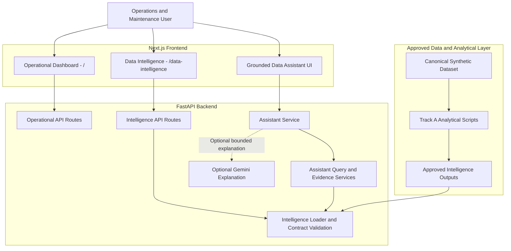

# POC-21 — Phase 3 Final Architecture

**Project:** Downtime Root Cause Explorer\
**Project ID:** POC-21\
**Phase:** Phase 3 — Posts #1 to #6\
**Application version:** 0.1.0\
**Canonical data version:** 1.1.0\
**Analytical method version:** 1.0.0\
**Approved analytical track:** Track A — Comparative Intelligence\
**Architecture document status:** Final certification architecture draft\
**Certification status:** Pending final reviewer signoff and authorized release activities

---

## 1. Executive Overview

Downtime Root Cause Explorer is a demonstration Business Intelligence application designed to help operations and maintenance users inspect downtime incidents, compare observed patterns and review evidence associated with recurring downtime.

Phase 3 extends the existing Phase 2 operational dashboard through a governed data and analytical foundation, a separate Data Intelligence page and a grounded assistant.

The implementation preserves the existing operational dashboard at `/` and provides the additional Data Intelligence route at `/data-intelligence`.

The approved analytical implementation is Track A — Comparative Intelligence. It produces deterministic descriptive comparisons across root-cause categories, machines and shifts using the approved canonical dataset.

The Grounded Data Assistant uses validated analytical findings. Its deterministic response remains authoritative. Gemini is an optional natural-language explanation layer and does not calculate or replace analytical findings.

All approved incident data used by this demonstration are synthetic. Results must not be interpreted as verified industrial performance, causal evidence or predictions.

## 2. Architecture Principles

The system follows these principles:

1. Preserve the Phase 2 operational dashboard and its existing API behaviour.
2. Keep the Data Intelligence experience on a separate route.
3. Use the approved canonical dataset and versioned analytical outputs.
4. Validate analytical outputs before they are served by the backend.
5. Keep analytical calculations in the approved data-science pipeline, not in frontend presentation code.
6. Keep assistant queries restricted to approved aggregate intelligence outputs.
7. Keep deterministic findings and evidence authoritative when Gemini is enabled.
8. Preserve synthetic-data, descriptive-analysis and small-group limitations.
9. Keep backend credentials and Gemini configuration server-side.
10. Record validation evidence and deployment limitations transparently.

## 3. High-Level System Architecture

The diagram represents the logical application flow. It does not imply that the frontend directly accesses the canonical CSV or that Gemini has unrestricted access to application data.

## 4. Technology Stack

### 4.1 Frontend

| Component | Technology |
|---|---|
| Framework | Next.js 16.4.3 |
| UI library | React 19.3.0 |
| Language | TypeScript 5.x |
| Styling | Tailwind CSS 4.x |
| Charts | Apache ECharts 6.1.0 |
| React chart integration | echarts-for-react 3.0.6 |
| Linting | ESLint 9.x |

The frontend package version is `0.1.0`.

### 4.2 Backend

| Component | Technology |
|---|---|
| API framework | FastAPI |
| Application server | Uvicorn |
| Data processing | Python and Pandas |
| Intelligence service | Project-specific validated loader |
| Assistant | Deterministic query and evidence services |
| Optional explanation | Google Gemini through backend configuration |

### 4.3 Analytical and Data Layer

| Component | Responsibility |
|---|---|
| Canonical CSV | Approved analytical input |
| Python analytical scripts | Profiling, readiness, comparative analysis and validation |
| JSON output package | Standardized findings, summary and validation metrics |
| Manifest and schema | Dataset identity, version and structure |

## 5. Frontend Architecture

### 5.1 Operational Dashboard

**Route:** `/`

The original Phase 2 operational dashboard remains the main landing page.

The existing dashboard includes:

- Operational KPI presentation.
- Cause Pareto chart.
- Frequency-versus-duration scatter chart.
- Root-cause tree.
- Machine and shift analysis.
- Incident investigation and supporting intelligence panel.

The page continues to use the existing operational backend endpoints.

Phase 3 certification preserves this page rather than replacing it with Data Intelligence.

### 5.2 Data Intelligence Page

**Route:** `/data-intelligence`

Implementation:

`frontend/src/app/data-intelligence/page.tsx`

Comparison component:

`frontend/src/app/data-intelligence/TrackAComparison.tsx`

The page presents the approved Track A findings and their supporting evidence.

Its principal content includes:

- Project and analytical metadata.
- Summary metrics.
- Dimension filters.
- Comparative results.
- Group comparisons.
- Evidence records.
- Methodology information.
- Analytical limitations.
- Freshness information.
- Grounded Data Assistant.

The page retrieves summary, results and metadata concurrently from the backend. It checks HTTP responses and approved data and method versions before displaying the package.

Dimension filtering is performed locally on the returned result collection using `result_category`. It is a presentation operation, not a new analytical calculation.

The page uses a seven-day default freshness threshold. An older valid generation timestamp is displayed as stale rather than silently presented as fresh.

### 5.3 Assistant User Interface

Assistant components are located under:

`frontend/src/app/components/data-assistant/`

The component set includes question input, answer presentation, status, evidence references, limitation notice and suggested questions.

The UI communicates the assistant response and its evidence and limitations. The frontend does not hold the Gemini API key.

## 6. Backend Architecture

The FastAPI application entry point is:

`backend/app/main.py`

Principal backend areas include:

| Location | Responsibility |
|---|---|
| `backend/app/analytics/` | Operational analytical functions |
| `backend/app/data/` | Data loading |
| `backend/app/intelligence/` | Approved intelligence package loading and validation |
| `backend/app/assistant/` | Assistant request orchestration |
| `backend/app/assistant/core/` | Assistant scope, classification, validation, routing, evidence and response logic |
| `backend/app/assistant/queries/` | Approved Track A query functions |

### 6.1 Intelligence Service

Implementation:

`backend/app/intelligence/service.py`

The intelligence service loads and validates the approved analytical package before it is served by the API.

The shared loader checks package identity, versions, required fields, numeric values, rankings, evidence, timestamps, result identifiers and validation status.

The API uses the shared loading and validation path rather than independently reconstructing analytical findings.

### 6.2 Operational Analytics

The existing operational functionality remains part of the backend.

Its presence and behaviour are preserved as part of the Phase 2 regression requirement. The operational page and Data Intelligence page are separate frontend experiences.

## 7. Canonical Data Foundation

The approved canonical analytical source is:

`data/canonical/intelligence_data.csv`

Supporting data governance files include:

- `data/manifest.json`
- `data/schema.json`
- `data/README.md`

Additional supporting data and quality artefacts are stored under:

- `data/published/`
- `data/quality/`
- `data/source-sample/`
- `data/synthetic/`

The approved canonical data version is `1.1.0`.

The validated canonical dataset contains:

| Property | Verified value |
|---|---:|
| Canonical measurement rows | 60 |
| Source incidents | 30 |
| Machines | 4 |
| Synthetic records | All approved records |

The source incidents are synthetic demonstration data. They must not be represented as observations from a real industrial operator.

## 8. Analytical Pipeline

### 8.1 Approved Track

**Track A — Comparative Intelligence**

Track A compares observed results across:

1. Root-cause category.
2. Machine.
3. Shift.

Approved metrics include incident count, total downtime, average downtime, failure-frequency totals and averages, and comparative ranking by total downtime.

### 8.2 Analytical Scripts

The principal scripts include:

| Script | Responsibility |
|---|---|
| `profile_canonical_data.py` | Canonical data profiling |
| `assess_data_quality.py` | Data quality assessment |
| `assess_analytical_readiness.py` | Analytical readiness |
| `assess_representativeness.py` | Representativeness assessment |
| `run_comparative_intelligence.py` | Comparative analysis |
| `export_intelligence_results.py` | Standardized result export |
| `validate_analytical_track.py` | Independent analytical validation |

The certification regeneration path uses `export_intelligence_results.py`.

The independent validation path uses `validate_analytical_track.py`.

Historical backup scripts and the older comparative validator are not identified as the certified execution path.

### 8.3 Approved Output Package

The principal outputs are:

- `data-science/outputs/intelligence_results.json`
- `data-science/outputs/intelligence_summary.json`
- `data-science/outputs/validation_metrics.json`

Supporting outputs include canonical profiling, quality, readiness, representativeness and weak-case review evidence.

### 8.4 Output Contract

The results export is a flat JSON array of 11 standardized analytical findings.

Each finding includes its result identifier, type, group, metric, value, unit, category, ranking, finding text, evidence, versions, generation timestamp, quality status and limitation.

The approved versions are:

- Data version: `1.1.0`
- Method version: `1.0.0`

The minimum group-size rule is three incidents.

The independent validator checks the actual exported JSON against calculations from the canonical dataset. It verifies the flat structure, result count, required fields, versions, numerical consistency, rankings and minimum group-size rule.

The overall validation result must be `PASS` only when the required checks succeed.

## 9. Intelligence API Architecture

The intelligence API prefix is:

`/api/intelligence`

The frontend API base is configured through:

`NEXT_PUBLIC_API_URL`

The default local backend URL is `http://localhost:8000`.

### 9.1 Implemented Endpoints

| Method | Endpoint | Purpose |
|---|---|---|
| GET | `/api/intelligence/summary` | Approved analytical summary |
| GET | `/api/intelligence/results` | Flat array of standardized findings |
| GET | `/api/intelligence/results/{result_id}` | Individual finding |
| GET | `/api/intelligence/metadata` | Project and analytical metadata |
| GET | `/api/intelligence/health` | Intelligence package health |

All five endpoints use the shared intelligence loader and contract validation.

### 9.2 Frontend Consumption

The Data Intelligence page directly consumes:

- `/api/intelligence/summary`
- `/api/intelligence/results`
- `/api/intelligence/metadata`

The individual result and health endpoints are implemented by the backend but are not identified as direct fetches in the inspected Data Intelligence page.

### 9.3 Error Behaviour

| HTTP status | Meaning |
|---|---|
| 200 | Requested resource returned |
| 404 | Requested result identifier not found |
| 503 | Intelligence package unavailable or contract validation failed |

The documented 503 mapping applies to handled package-loading and validation exceptions. It is not a claim that every possible server or transport failure has been tested.

## 10. Grounded Data Assistant Architecture

The assistant API endpoint is:

`POST /api/assistant/query`

The assistant is restricted to approved category, machine and shift comparisons.

### 10.1 Request and Scope

The question must be a non-empty string of at most 500 characters.

Supported scope statuses are:

- `SUPPORTED`
- `MISSING_PARAMETER`
- `AMBIGUOUS`
- `OUT_OF_SCOPE`
- `UNSAFE`
- `UNAVAILABLE`

Only approved intent identifiers and validated parameters are accepted.

Client-provided SQL, file paths, result values and arbitrary filter expressions are not accepted.

### 10.2 Deterministic Mode A

Mode A is the authoritative assistant mode.

Its flow is:

1. Receive and validate the question.
2. Apply scope and safety checks.
3. Classify an approved intent.
4. Validate required parameters.
5. Route to a fixed query function.
6. Load approved Track A results through the validated service.
7. Build a bounded evidence package.
8. Compose and validate the deterministic answer.
9. Return the answer with evidence and limitations.

Mode A uses zero LLM turns.

### 10.3 Optional Gemini Mode B

Mode B uses the deterministic response as the basis for an optional natural-language explanation.

Gemini receives bounded approved context, not unrestricted application data.

Gemini must not calculate or modify analytical values, introduce unsupported rankings, invent evidence or add unsupported causal, predictive or maintenance claims.

The deterministic answer, approved values, evidence references, versions and limitations remain authoritative.

Missing credentials, API errors, timeouts or invalid explanations must not remove the deterministic answer or its evidence. The assistant uses its configured safe fallback behaviour.

### 10.4 Assistant Limits

The documented assistant limits include:

| Limit | Maximum |
|---|---:|
| Question length | 500 characters |
| Returned results | 25 |
| Evidence references | 10 |
| Follow-ups | 3 |
| Evidence excerpt | 300 characters |

### 10.5 Assistant Error Behaviour

| HTTP status | Meaning |
|---|---|
| 422 | Invalid input |
| 503 | Approved intelligence package unavailable |
| 500 | Unexpected internal failure, returned without secrets or stack traces |

### 10.6 Assistant Data and Security Boundaries

Assistant query modules use approved aggregate intelligence outputs only. They must not directly access the canonical CSV.

The assistant must not expose credentials, environment variables, internal prompts or unrestricted records. Requests for secrets, system prompts, arbitrary SQL, code execution and external URLs are rejected or treated as outside the supported scope.

Evidence content is treated as untrusted input. The assistant does not alter or recalculate source scores and rankings.

No persistent conversation memory is part of the documented assistant design. Question text and sensitive content should not be written to logs.

## 11. Analytical Findings and Interpretation

The verified approved summary reported:

| Measure | Observed value |
|---|---:|
| Source incidents | 30 |
| Total downtime | 2,795 minutes |
| Average downtime | 93.1667 minutes |
| Total failure frequency | 65 |

Leading observed comparisons:

| Dimension | Leading group | Observed downtime |
|---|---|---:|
| Root-cause category | Mechanical | 1,265 minutes |
| Machine | MCH-02 | 850 minutes |
| Shift | Morning | 1,060 minutes |

These values describe the approved synthetic dataset only. They do not establish that the same patterns exist in a real facility.

Comparative rankings are descriptive and may change as additional observations become available. Small groups may have reduced ranking stability.

## 12. Security, Privacy and Public-Demo Boundaries

The application is publicly accessible through its Render deployment.

The inspected backend also exposes existing incident endpoints and CSV/JSON exports that are public and unpaginated. This is a separate existing exposure risk and must not be mistaken for an assistant capability or treated as resolved by the assistant restrictions.

The approved public demonstration is limited to synthetic data.

Before introducing real, personal or restricted operational data, access controls and data-exposure risks must be reassessed.

Gemini credentials are configured on the backend only. They must not be exposed through frontend code, browser responses, logs, screenshots or committed files.

The assistant must not receive unrestricted file access, arbitrary SQL, executable code, secrets or external retrieval capabilities.

## 13. Deployment Architecture

### 13.1 Render

The Render configuration defines two Docker-based web services in the Singapore region:

| Service | Dockerfile | Health configuration |
|---|---|---|
| Backend | `backend/Dockerfile` | `/health` |
| Frontend | `frontend/Dockerfile` | Frontend web service |

Verified public endpoints:

- Frontend: `https://downtime-frontend-phase3.onrender.com`
- Data Intelligence: `https://downtime-frontend-phase3.onrender.com/data-intelligence`
- Backend: `https://downtime-backend-phase3.onrender.com`
- Backend health: `https://downtime-backend-phase3.onrender.com/health`

Deployment validation confirmed HTTP 200 for the frontend routes and backend health endpoint. The backend health response reported a healthy status.

The deployed source commit and Render build identity were not independently verified during the recorded deployment validation.

### 13.2 Local Docker Compose

The root `docker-compose.yml` defines:

| Service | Host port | Container port |
|---|---:|---:|
| Backend | 8000 | 8000 |
| Frontend | 3000 | 3000 |

Both services are built using their respective Dockerfiles.

The frontend receives:

`NEXT_PUBLIC_API_URL=http://localhost:8000`

The Compose configuration declares the frontend dependency on the backend.

Container validation confirmed successful image builds, startup, backend health and HTTP 200 responses for the local frontend routes.

The initial container build encountered a transient TLS/network failure before succeeding on a subsequent attempt. Existing Phase 2 containers were preserved by renaming them before starting the Phase 3 Compose services.

The local container test verified API and route availability; it did not perform a complete browser-based interaction test inside the containers.

## 14. Certification Verification Summary

The following results were recorded during the Post #6 certification work.

| Area | Recorded result |
|---|---|
| Pre-certification Repomix | Generated |
| Clean clone | Passed |
| Canonical data validation | Passed |
| Data readiness revalidation | Passed |
| Analytical regeneration | Reproducibility checks passed |
| Intelligence contract validation | Passed |
| Frontend lint, TypeScript and production build | Passed |
| Backend tests | Passed |
| Operational regression | Passed for recorded checks |
| Data Intelligence validation | Passed for recorded checks |
| Assistant validation | Passed for recorded checks |
| Consolidated automated suite | 64 passed, 0 failed, 1 warning |
| Final Selenium journey | Passed |
| Final technical UAT | Passed |
| Deployment validation | Passed for recorded endpoint checks |
| Container validation | Passed for recorded local checks |

The consolidated automated test warning concerned the Starlette test-client use of `httpx`, which is deprecated in the installed combination. It was recorded rather than silently suppressed or changed during certification.

The clean-clone installation also reported seven moderate npm audit vulnerabilities, deprecated ESLint package warnings and an unapproved dependency post-install script. No automated dependency remediation or script approval was performed during certification.

The recorded checks are evidence of the stated validation scope. They are not a claim of a complete security audit, exhaustive failure testing or production-readiness assessment for real industrial data.

## 15. Known Limitations and Open Risks

1. The approved incident dataset is synthetic.
2. Track A is descriptive and comparative only.
3. No causal, predictive, probability-of-failure or generalization claim is supported.
4. Small comparison groups may have reduced ranking stability.
5. The currently approved output timestamp is `2026-11-07T09:53:54Z`; the page correctly reports the package as stale against its seven-day default threshold during the November 2026 certification checks.
6. The Starlette/httpx deprecation warning remains documented.
7. The npm installation reported seven moderate vulnerabilities and package warnings.
8. The initial Docker build experienced a transient TLS failure before a successful retry.
9. A complete browser-based interaction test inside the local containers was not performed.
10. A comprehensive security scan and orchestration assessment were not part of the recorded container validation.
11. The public incident endpoints and CSV/JSON exports were observed to be unpaginated and publicly accessible; this remains a separate exposure risk.
12. The deployed source commit and Render build identity were not independently verified in the deployment report.
13. Final reviewer signoff and authorized release/submission activities remain pending.

## 16. Architectural Change Boundaries

The following boundaries preserve the approved Phase 3 scope:

- The Phase 2 operational dashboard remains available at `/`.
- The Data Intelligence page remains a separate route.
- Approved Track A outputs remain the source of comparative findings.
- Frontend filters do not recalculate analytical results.
- Assistant queries use approved aggregate results and bounded evidence.
- Gemini remains an optional explanation layer.
- Assistant functionality does not replace or modify the existing intelligence API.
- Synthetic-data limitations remain visible and documented.
- No unapproved analytical track, dataset or result package is introduced.

## 17. Key Implementation References

| Area | Reference |
|---|---|
| Frontend operational page | `frontend/src/app/page.tsx` |
| Frontend Data Intelligence page | `frontend/src/app/data-intelligence/page.tsx` |
| Track A comparison component | `frontend/src/app/data-intelligence/TrackAComparison.tsx` |
| Frontend assistant components | `frontend/src/app/components/data-assistant/` |
| FastAPI entry point | `backend/app/main.py` |
| Intelligence service | `backend/app/intelligence/service.py` |
| Assistant service | `backend/app/assistant/service.py` |
| Assistant core | `backend/app/assistant/core/` |
| Assistant Track A queries | `backend/app/assistant/queries/track_a_queries.py` |
| Canonical dataset | `data/canonical/intelligence_data.csv` |
| Data manifest | `data/manifest.json` |
| Data schema | `data/schema.json` |
| Analytical exporter | `data-science/scripts/export_intelligence_results.py` |
| Analytical validator | `data-science/scripts/validate_analytical_track.py` |
| Intelligence results | `data-science/outputs/intelligence_results.json` |
| Intelligence summary | `data-science/outputs/intelligence_summary.json` |
| Validation metrics | `data-science/outputs/validation_metrics.json` |
| Render configuration | `render.yaml` |
| Local container configuration | `docker-compose.yml` |

## 18. Final Architecture Statement

POC-21 Phase 3 is structured as a versioned, synthetic-data demonstration application with a preserved operational dashboard, a separate Track A Data Intelligence experience and a bounded Grounded Data Assistant.

Its analytical findings are generated through the approved reusable pipeline, exported as standardized JSON results and independently validated against the canonical dataset before being served by the backend.

The frontend presents those approved findings and evidence without performing new analytical calculations. The assistant retrieves validated findings through deterministic query functions. Gemini, when configured, provides only a bounded explanation of the deterministic response.

The architecture, implementation references, validation results and limitations are documented for final certification review.

**Architecture document status:** Prepared for Post #6 certification evidence.\
**Final certification status:** Pending completion of remaining certification steps, reviewer signoff and authorized release/submission activities.